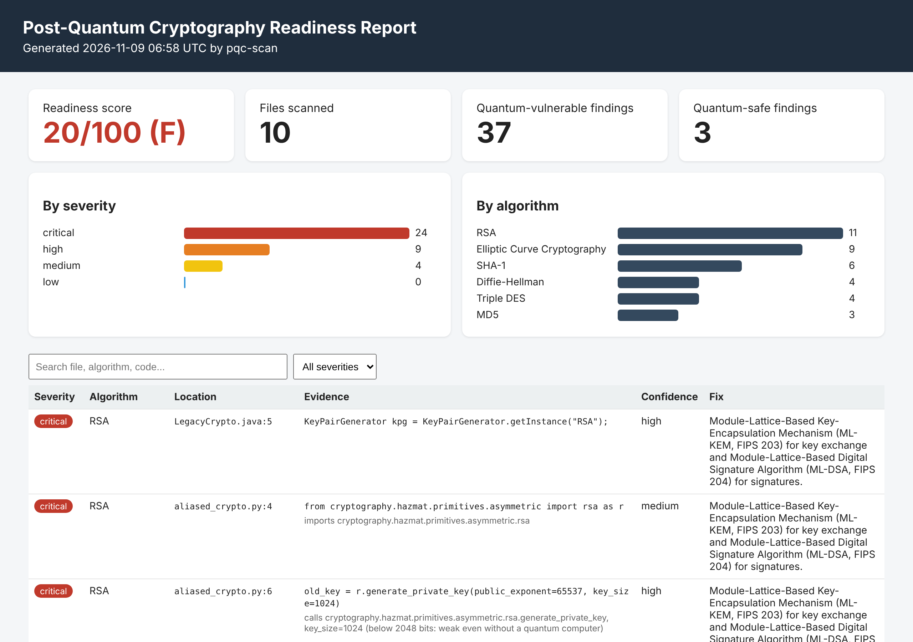

# PQC Migration Scanner

[](https://github.com/taufiqbo/Post_Quantum_Computing-Migration_tool/actions/workflows/tests.yml)

A Python tool that finds **quantum-vulnerable cryptography** in source code, server configuration files and X.509 certificates, and maps every finding to its **NIST post-quantum replacement** (ML-KEM, ML-DSA, SLH-DSA).

It answers the first question of any post-quantum migration: *"Where is our cryptography, and what do we need to change?"*



---

## Why this matters

Large quantum computers running **Shor's algorithm** will break the public-key cryptography that protects almost everything today: **RSA, elliptic curves (ECDSA/ECDH) and Diffie-Hellman**.

That sounds like a future problem, but it isn't, because of **"harvest now, decrypt later" (HNDL)**. Attackers can record encrypted traffic today and decrypt it once a quantum computer exists. Anything that must stay secret for years is already at risk.

NIST published the replacement standards in 2024, and NIST IR 8547 plans to **deprecate RSA and ECC after 2030 and disallow them after 2035**. Organisations can't migrate what they can't find, so the first step is a **cryptographic inventory**. This tool builds one.

| NIST standard | Replaces | Used for |
|---|---|---|
| **ML-KEM** (FIPS 203) | RSA / ECDH / DH key exchange | Agreeing on a shared secret key |
| **ML-DSA** (FIPS 204) | RSA / ECDSA / DSA signatures | Digital signatures, certificates |
| **SLH-DSA** (FIPS 205) | RSA / ECDSA / DSA signatures | Hash-based backup signature scheme |

---

## What it scans

| Scanner | Looks at | How |
|---|---|---|
| **Regex scanner** | Python, Java, JavaScript, Go, C/C++, C#, and more | Pattern matching on each line, e.g. `KeyPairGenerator.getInstance("RSA")` |
| **Python AST scanner** | Python files | Reads the code's structure, so it follows aliases (`import rsa as r`) and reads RSA key sizes |
| **Config scanner** | nginx, Apache, OpenSSH, OpenSSL configs | Splits cipher strings into tokens (`ECDHE-RSA-AES128-SHA` = ECC + RSA + SHA-1) and ignores disabled ones (`!MD5`) |
| **Certificate scanner** | `.pem`, `.crt`, `.cer`, `.der` | Reads algorithm OIDs, key size, signature hash and expiry date (and warns if a certificate outlives NIST's 2035 cut-off) |

It detects **RSA, ECC, Diffie-Hellman, DSA, SHA-1, MD5 and 3DES**, and recognises quantum-safe **ML-KEM, ML-DSA and SLH-DSA** (including hybrids like `X25519MLKEM768`).

---

## Quick start

Requires Python 3.10 or newer.

```bash
git clone https://github.com/taufiqbo/Post_Quantum_Computing-Migration_tool.git
cd Post_Quantum_Computing-Migration_tool
python -m venv .venv
```

Activate the virtual environment:

```bash
.venv\Scripts\Activate.ps1      # Windows PowerShell
source .venv/bin/activate       # Linux / macOS
```

Install, then scan the included samples:

```bash
pip install -e .
pqc-scan samples --html reports/report.html
```

Open `reports/report.html` in your browser.

---

## Usage

```text
pqc-scan [folder] [options]

  folder                  folder to scan (default: current folder)
  --exclude PATTERN       skip files or folders by name, e.g. tests or *.yaml (repeatable)
  --min-confidence LEVEL  low | medium | high (default: low = show everything)
  --html FILE             save an HTML report (score, charts, filterable table)
  --json FILE             save results as JSON
  --csv FILE              save results as CSV (opens in Excel)
  --quiet                 print only the summary
```

Examples:

```bash
pqc-scan samples --quiet
pqc-scan /path/to/your/project --exclude node_modules --exclude tests --html report.html
pqc-scan samples --min-confidence high --json results.json --csv results.csv
```

Example output:

```text
[CRITICAL] RSA                          certs/legacy_sha1.crt:1  (high)
           certificate CN=legacy.example.com
           detail: public key: RSA 1024-bit (below 2048 bits: weak even without a quantum computer), expires 2024-01-01 (ALREADY EXPIRED)
           fix: ML-DSA (FIPS 204) or SLH-DSA (FIPS 205) certificate, once your certificate authority and clients support it.

Scanned 10 files: 37 quantum-vulnerable findings, 3 quantum-safe findings.
Quantum-readiness score: 20/100 (grade F)
```

---

## How findings are rated

**Severity** comes from the quantum (and classical) threat:

| Severity | Algorithms | Why |
|---|---|---|
| Critical | RSA, ECC, DH | Broken by Shor's algorithm; key exchange is exposed to HNDL today |
| High | DSA, SHA-1, MD5 | DSA is broken by Shor; SHA-1 and MD5 are already broken classically |
| Medium | 3DES | 64-bit block (Sweet32), and Grover's algorithm halves its strength |
| Info | ML-KEM, ML-DSA, SLH-DSA | Quantum-safe: reported as good news |

**Confidence** says how sure the scanner is:
- **high**: a specific API call or config setting (`rsa.generate_private_key(...)`, `KexAlgorithms ...`)
- **medium**: an import or a bare algorithm name
- **low**: found inside a code comment

**Quantum-readiness score (0 to 100).** Each scanned file scores according to its *worst* quantum-vulnerable finding (none = 100, low = 90, medium = 70, high = 40, critical = 0), and the project score is the average. Quantum-safe and low-confidence findings don't lower it. Grades: A ≥ 90, B ≥ 75, C ≥ 50, D ≥ 25, F below.

**Use-case-aware fixes.** Certificates are signatures, so the scanner recommends ML-DSA / SLH-DSA for them, not ML-KEM. Key exchange (TLS, SSH) should move to ML-KEM hybrids first, because that is what HNDL attacks.

---

## How it works

```text
pqc_scanner/
├── rules/algorithms.yaml   detection rules: severity, threat, NIST replacement, patterns
├── rules.py                loads the YAML into Rule objects, compiles regexes
├── scanner.py              walks folders and sends each file to the right scanner
├── ast_scanner.py          Python AST scanner (aliases, key sizes)
├── config_scanner.py       nginx / Apache / OpenSSH / OpenSSL configs
├── cert_scanner.py         X.509 certificates (PEM and DER)
├── report.py               readiness score, JSON / CSV / HTML reports
├── cli.py                  the pqc-scan command (argparse)
└── models.py               the Finding data class
```

All detection logic lives in **one YAML file**, separate from the code. Adding a new algorithm or pattern means editing data, not Python.

Every value from a scanned file is HTML-escaped before it goes into the report, so a malicious file can't inject a script into the report (XSS).

---

## Tests

```bash
pip install pytest
python -m pytest
```

44 tests cover every scanner, including regression tests for false negatives found during development (e.g. Node.js `generateKeyPairSync('rsa')`) and false positives (disabled ciphers like `!MD5`, quantum-safe names in comments). GitHub Actions runs them on Windows and Linux for every push, and saves a sample HTML report as a downloadable artifact.

---

## Limitations and roadmap

This is a learning and portfolio project, not a replacement for commercial cryptographic discovery tools.

- Pattern-based detection can miss crypto hidden behind wrappers, dynamic code or compiled binaries.
- Cipher aliases such as `HIGH` or `DEFAULT` in OpenSSL strings are not expanded yet.
- It doesn't connect to live servers to check what they actually negotiate.

Planned: git history scanning, cipher alias expansion, a `--fail-on` option to block pull requests that add vulnerable crypto, and a Streamlit web interface.

---

## About

Built by **Mohamad Taufiq** as part of a cybersecurity portfolio on post-quantum security. The step-by-step build notes are in [docs/learning-log.md](docs/learning-log.md).

**References:** [NIST FIPS 203 (ML-KEM)](https://csrc.nist.gov/pubs/fips/203/final) · [NIST FIPS 204 (ML-DSA)](https://csrc.nist.gov/pubs/fips/204/final) · [NIST FIPS 205 (SLH-DSA)](https://csrc.nist.gov/pubs/fips/205/final) · [NIST IR 8547 (transition timeline)](https://csrc.nist.gov/pubs/ir/8547/ipd)
